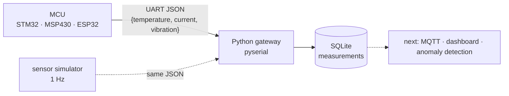

<div align="center">

# 🌐 Python IoT Labs

**Python on the host side of embedded systems: reading microcontroller telemetry over UART, storing it, simulating sensors, testing.**


</div>

> **RU:** Python на стороне компьютера: читаем телеметрию с микроконтроллера по UART (JSON), пишем в SQLite, симулируем датчики, тестируем.
> **TR:** Bilgisayar tarafında Python: mikrodenetleyiciden UART ile telemetri (JSON) okuma, SQLite'a kaydetme, sensör simülasyonu, test.

## 🗂️ Projects

| Folder | What it does |
|---|---|
| [`projects/uart_sqlite_gateway/`](projects/uart_sqlite_gateway) | gateway: reads one JSON line per measurement from an STM32 / MSP430 / ESP32 over UART (115200 baud) → SQLite table `measurements` (timestamp, temperature, current, vibration) |
| [`projects/ntc_serial_reader/`](projects/ntc_serial_reader) | Arduino sketch reads an NTC thermistor on an analog pin and sends JSON at 115200 baud; Python finds the board's port automatically and prints the temperature |
| [`projects/sensor_sim_gateway/`](projects/sensor_sim_gateway) | sensor simulator (JSON at 1 Hz) + gateway that reads it, project layout `src/ tests/`, pytest |



## 🚀 Run

```bash
cd projects/uart_sqlite_gateway
python3 -m venv .venv && source .venv/bin/activate && pip install -r requirements.txt
# set PORT in src/iot_gateway/gateway/main.py (e.g. /dev/tty.usbmodem*)
cd src/iot_gateway/gateway && python3 main.py

cd projects/sensor_sim_gateway/src/sensor_sim && python3 simulator.py   # prints JSON every second
```

## 🛣️ Next
- [ ] Publish to an MQTT broker (`paho-mqtt` is already in requirements)
- [ ] Live plot / dashboard, then simple anomaly detection on current and vibration
